<h1 align="center">
  
</h1>

<p align="center"><strong>Keep your remote shell when your network changes.</strong><br>
Connect from PowerShell, or host a shell on your Windows PC. Both the Mosh client and server run natively.</p>

<p align="center">
  <a href="https://github.com/Yuanpeng-Li/mosh-windows/releases/latest"></a>
</p>

<p align="center">
  <a href="#quick-start">Quick start</a> &nbsp;·&nbsp;
  <a href="README.windows.md#connecting-in">Host on Windows</a> &nbsp;·&nbsp;
  <a href="README.windows.md#troubleshooting">Troubleshooting</a> &nbsp;·&nbsp;
  <a href="https://github.com/Yuanpeng-Li/mosh-windows/releases">Release notes</a>
</p>

## Quick start

Download the **x64 ZIP** from the latest release, extract it, and open PowerShell in the extracted `mosh` folder. You'll need Windows 10 version 1809 or newer, or Windows 11.

**Try it on one PC.** This opens a second shell through Mosh on your own machine. Type `exit` to return.

```powershell
.\mosh.exe --local localhost
```

**Connect to another machine.** Replace `dev@lab` with your SSH login. The host needs SSH, `mosh-server`, and an inbound UDP port in the default range **60000–61000**. SSH handles the login, then Mosh carries the terminal over encrypted UDP.

```powershell
.\mosh.exe dev@lab
```

Prefer to type `mosh` from any directory? The [per-user installer](README.windows.md#install) sets up your PATH and includes an uninstaller.

## Try switching networks

In the remote shell, print its process ID. Switch your **laptop** from Wi-Fi to a hotspot that can reach the same server. Once Mosh reconnects, run the command again. The same ID means you're still in the original shell, with its working directory and running programs.

| If the remote prompt is… | Run before and after switching |
| --- | --- |
| PowerShell on Windows | `$PID` |
| Bash or Zsh on Linux or macOS | `echo $$` |

On a slow link, you can also see Mosh's local echo in action. It predicts ordinary keystrokes and reconciles the display when the server replies.

## Choose your connection

| From | To | Setup |
| --- | --- | --- |
| Windows | Linux or macOS | Install this port on the client and the distribution's Mosh package on the host. Connect with `mosh user@host`. [Client guide](README.windows.md#connecting-out) |
| Windows | Windows | Install this port on both machines. Enable OpenSSH Server and allow inbound UDP for the host's `mosh-server.exe`. [Host setup](README.windows.md#connecting-in) |
| Linux or macOS | Windows | Use your packaged client with `mosh --no-ssh-pty user@windows-box`. The [Unix launcher](README.windows.md#your-linux-or-macos-client-needs-one-thing) handles this automatically. |

<details>
<summary><strong>Connection recipes</strong> — SSH aliases, custom ports, and tmux</summary>

After installing on PATH, you can use your usual SSH alias. Set the SSH port and the Mosh UDP port independently.

```powershell
mosh lab                         # Host lab in your SSH config
mosh --ssh="ssh -p 2222" dev@lab # SSH login on TCP 2222
mosh -p 60010 dev@lab            # Mosh traffic on UDP 60010
```

You can also attach to an existing tmux session on a Unix host.

```powershell
mosh dev@lab tmux attach
```

</details>

## Updates

The **first Windows release after v0.2.0** adds the built-in updater. If you're on v0.2.0 or earlier, install a newer ZIP once that release is available. After that, the launcher can check the latest stable version, verify its SHA-256, and update the scripts and executables together.

```powershell
mosh --version
mosh update --check
mosh update
```

In a portable installation, use `.\mosh.exe` in place of `mosh`. For a WinGet-managed install, use `winget upgrade --id YuanpengLi.MoshWindows --exact`.

<details>
<summary><strong>Which release file should I download?</strong></summary>

| Asset | Purpose |
| --- | --- |
| `mosh-windows-x64-vX.Y.Z.zip` | Complete installation with the matching programs and scripts. |
| `mosh.exe` | Launcher for packagers. It needs the matching scripts from the ZIP. |
| `mosh-client.exe` · `mosh-server.exe` | Individual native binaries for integration. |
| `SHA256SUMS` | Compare a download's digest with `Get-FileHash -Algorithm SHA256 <file>`. |

Individual EXEs and checksums ship alongside the ZIP starting with the first release after v0.2.0.

</details>

## Development

The Windows port uses **MSVC, CMake, vcpkg, and ConPTY**. The tests exercise the terminal, protocol, and Windows loopback sessions. When reporting a problem, include your Windows build, the output of `mosh --version`, and which machine was the client.

[](https://github.com/Yuanpeng-Li/mosh-windows/actions/workflows/windows.yml)
[Build on Windows](README.windows.md#build-it-yourself) · [CMake options](docs/cmake-build.md) · [Report an issue](https://github.com/Yuanpeng-Li/mosh-windows/issues)

Mosh was created by Keith Winstein and the Mosh developers. This independent fork adds native Windows support and retains the upstream GPLv3-or-later license and OpenSSL linking exception. [Upstream Mosh](https://mosh.org/) · [Source](https://github.com/mobile-shell/mosh) · [License](COPYING)
